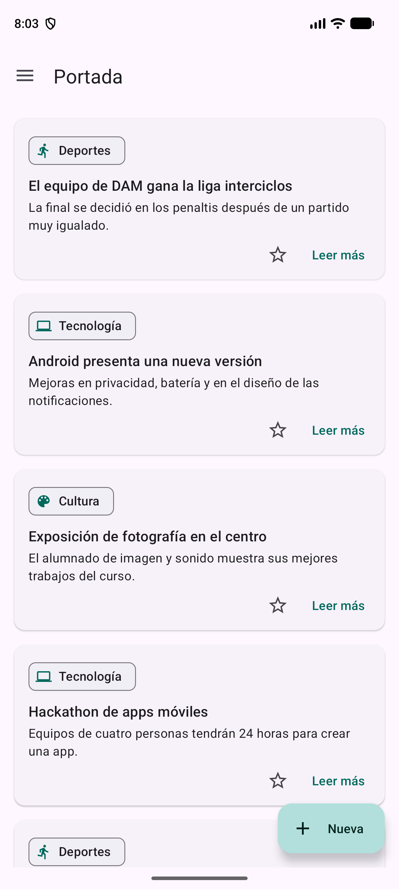
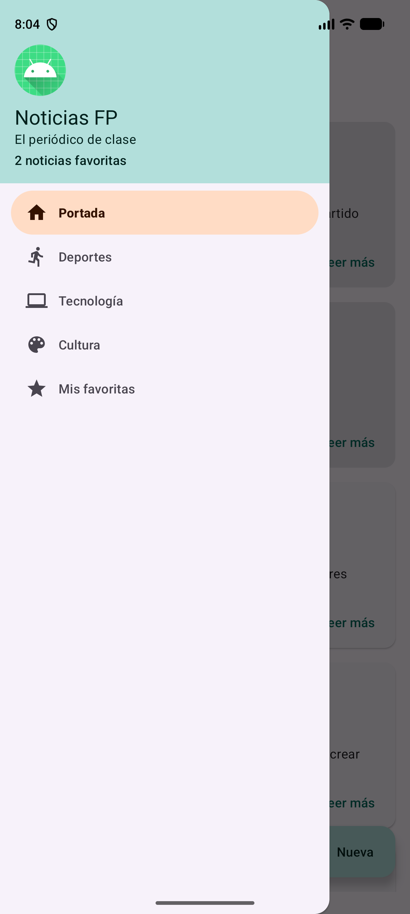
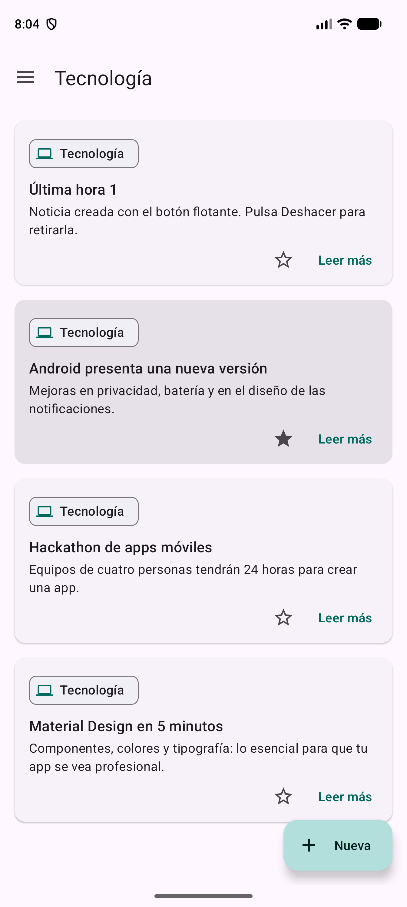
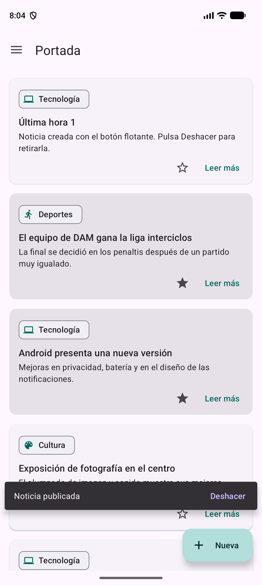
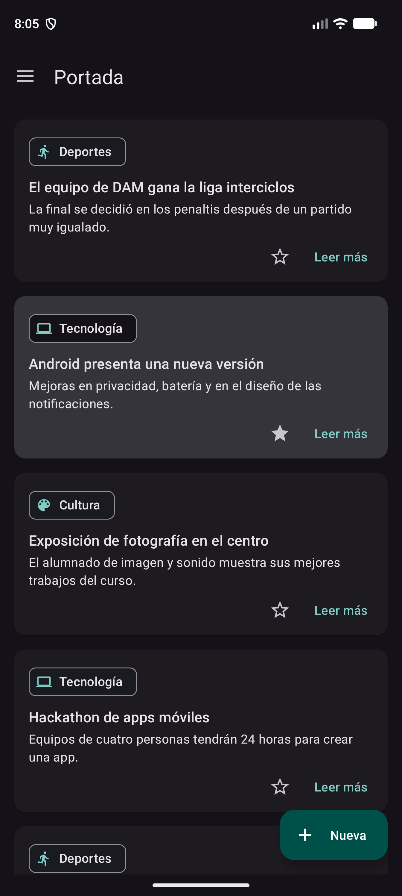

# Noticias FP · Material Design — Entrega

**Unidad 2 · Programación Multimedia y Dispositivos Móviles** · Curso 2.º DAM

**Integrantes:** Sergio Salido, David Cecilia y Sergio Lastras

En esta práctica hemos trabajado una aplicación de noticias utilizando componentes de Material Design, como la
barra superior, el menú lateral, tarjetas con categorías y el botón flotante para publicar noticias.

Proyecto Android (Java + layouts XML), paquete `com.ejemplo.noticias`, API mínima 24. El documento original del
grupo está en [`docs/NoticiasFP_MaterialDesign_Grupo.pdf`](docs/NoticiasFP_MaterialDesign_Grupo.pdf).

## 1. Capturas de las pruebas

### Captura 1. Pantalla principal: Portada
Se muestra la pantalla de inicio con varias noticias organizadas en tarjetas. Cada una tiene su categoría, un
resumen, el botón «Leer más» y la opción de marcarla como favorita. También aparece el botón flotante «Nueva».

### Captura 2. Menú lateral de navegación
Al pulsar el icono de menú se abre el Navigation Drawer, con las secciones Portada, Deportes, Tecnología, Cultura y
Mis favoritas. En la cabecera se ve el nombre de la aplicación y el contador de favoritos.

### Captura 3. Filtro de Tecnología
Tras elegir la sección Tecnología, la barra superior cambia de título y solo se muestran noticias de esa categoría.
Esto permite comprobar el funcionamiento del filtro del menú lateral.

### Captura 4. Publicación y opción Deshacer
Al pulsar el botón flotante «Nueva» se añade una noticia al inicio de la lista. En la captura aparece la noticia
«Última hora» y el Snackbar «Noticia publicada», con el botón «Deshacer» para retirar la noticia recién creada.

### Captura 5. Modo oscuro
Al activar el modo oscuro del emulador, la aplicación adapta los fondos, las tarjetas y los controles a la paleta
oscura definida en el tema. La estructura y las noticias se mantienen.

### Resto de pruebas del paso 9

| Prueba | Captura | Resultado |
|---|---|---|
| La app arranca | `01_arranque.png` | Barra «Portada» con ☰ y tarjetas con chip de categoría ✔ |
| Marcar dos estrellas | `02_dos_favoritas.png` | Estrella llena y tarjeta Filled ✔ |
| Pulsar ☰ | `03_panel_abierto.png` | Panel con cabecera, contador «2 noticias favoritas» y secciones ✔ |
| Atrás con el panel abierto | `04_atras_cierra_panel.png` | Se cierra el panel y la app sigue abierta ✔ |
| Pulsar «Nueva» | `05_nueva_snackbar.png` | «Última hora 1» arriba y Snackbar con «Deshacer» encima del FAB ✔ |
| Pulsar «Deshacer» | — | La noticia recién publicada desaparece ✔ |
| Desplazar hacia abajo / arriba | `06_fab_encogido.png` | El FAB se encoge a solo icono y vuelve a estirarse ✔ |
| Elegir «Tecnología» | `07_seccion_tecnologia.png` | Solo noticias de tecnología, título cambiado y opción marcada ✔ |
| «Mis favoritas» | `08_mis_favoritas.png` | Solo aparecen las dos marcadas ✔ |
| Desmarcar una en «Mis favoritas» | `09_desmarcar_favorita.png` | La tarjeta desaparece ✔ |
| Modo oscuro | `10_modo_oscuro.png`, `11_modo_oscuro_panel.png` | Colores de `values-night`; se conservan sección y favoritas ✔ |

Pruebas realizadas en el emulador `sdk_gphone16k_x86_64`.

## 2. Ejercicios de ampliación realizados

### Ejercicio 3 · Contador en el panel
La cabecera (`nav_header.xml`) tiene un `TextView` `tvContadorFavoritas`. `MainActivity` lo obtiene con
`binding.navView.getHeaderView(0).findViewById(...)` y lo actualiza con `actualizarContadorFavoritas()` cada vez que
se aplica el filtro o se marca o desmarca una favorita. Usa `plurals` para escribir «1 noticia favorita» o
«N noticias favoritas».

### Ejercicio 4 · Tipos de tarjeta
`item_noticia.xml` usa `Widget.Material3.CardView.Elevated`. En `NoticiaAdapter.mostrar()` las favoritas se pintan
como tarjeta **Filled** (elevación 0 y fondo `?attr/colorSurfaceContainerHighest`, el mismo rol que usa el estilo
Filled); las demás recuperan la elevación y el fondo del estilo Elevated.

**¿Qué transmite cada estilo?** La tarjeta **Elevated** tiene sombra y parece «flotar» sobre el fondo, así que
destaca como contenido independiente. La tarjeta **Filled** no tiene sombra y tiene un fondo tonal más intenso: se ve
más integrada y «guardada», y marca bien un estado distinto, las noticias que el usuario ya ha separado como suyas.

### Mejora adicional
Al cambiar a modo oscuro o girar la pantalla la Activity se recrea. La sección elegida y las favoritas se guardan en
`onSaveInstanceState` y se recuperan en `onCreate`, para no perderlas.

## 3. Preguntas de comprobación

**1. ¿Qué ventaja tiene definir los colores en el tema en lugar de en cada vista?**
Permite mantener el mismo estilo en toda la aplicación y cambiar los colores desde un único lugar. Además, facilita
que la app tenga una versión clara y otra oscura sin tener que modificar cada componente por separado.

**2. ¿Qué diferencia hay entre `@color/marca_primario` y `?attr/colorPrimary`?**
`@color/marca_primario` utiliza directamente un color concreto de los recursos. En cambio, `?attr/colorPrimary`
consulta el color principal definido en el tema activo, por lo que puede cambiar automáticamente al pasar de modo
claro a oscuro.

**3. ¿Cuándo usarías un Navigation Drawer y cuándo una Bottom Navigation?**
Usaría Navigation Drawer cuando la aplicación tiene bastantes secciones o algunas se utilizan menos, porque permite
reunirlas en un panel lateral. Bottom Navigation es más adecuada para entre tres y cinco secciones principales a las
que se accede constantemente.

**4. ¿Por qué solo debe haber un FAB por pantalla?**
Porque el FAB destaca la acción principal que puede hacer el usuario. Si hubiera varios, perdería importancia y la
pantalla podría resultar confusa. En nuestra app lo utilizamos para publicar una noticia nueva.

**5. ¿Qué dos hijos tiene un DrawerLayout y qué atributo necesita el segundo?**
El primer hijo es el contenido principal de la pantalla, con las noticias y la barra superior. El segundo es el
`NavigationView`, que representa el panel lateral y necesita `android:layout_gravity="start"` para aparecer desde el
lado inicial de la pantalla.

**6. ¿Para qué sirve `setAnchorView` en un Snackbar?**
Sirve para colocar el Snackbar teniendo en cuenta otra vista, por ejemplo el botón flotante. Así el aviso aparece por
encima del FAB y no lo tapa cuando se muestra el mensaje «Noticia publicada» con «Deshacer».
