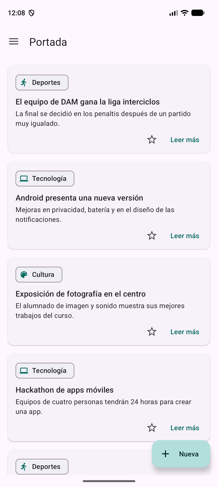
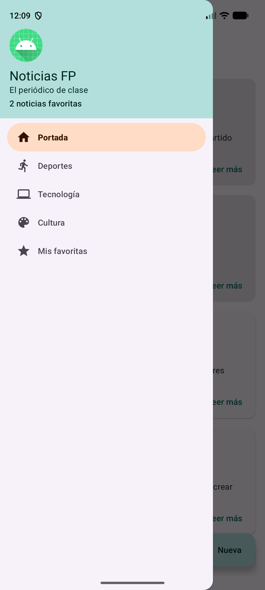
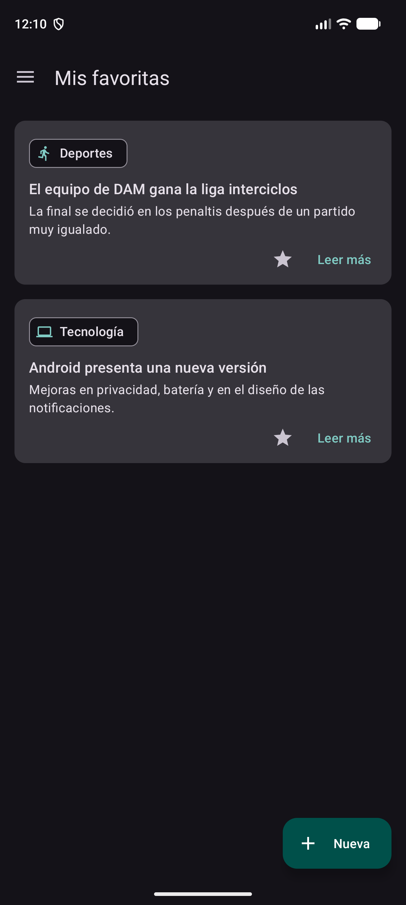

# Noticias FP · Material Design

Práctica de la Unidad 2 (bloque 3) del módulo 0489 *Programación multimedia y dispositivos móviles* (DAM).

Es un periódico de clase hecho en Android (Java y layouts XML) con componentes de Material 3:

- **Tema propio** claro y oscuro (`values/themes.xml` y `values-night/themes.xml`), y las vistas usan `?attr/…`.
- **Top App Bar** (`MaterialToolbar`) cuyo título cambia según la sección.
- **Navigation Drawer** con cabecera y secciones Portada, Deportes, Tecnología, Cultura y Mis favoritas. Al pulsar Atrás, primero se cierra el panel.
- **MaterialCardView** con **Chip** de categoría, botón de favorita y botón de texto «Leer más».
- **Extended FAB**, que se encoge al desplazar la lista, y **Snackbar** con «Deshacer».
- Ampliaciones: contador de favoritas en la cabecera del panel, y tarjetas Filled para las favoritas frente a Elevated para el resto.

| Portada | Panel lateral | Modo oscuro |
|---|---|---|
|  |  |  |

Las pruebas completas, las respuestas a las preguntas y la explicación de las ampliaciones están en [ENTREGA.md](ENTREGA.md).

## Ejecutar

Abre la carpeta en Android Studio y ejecuta la configuración `app` (API mínima 24).
